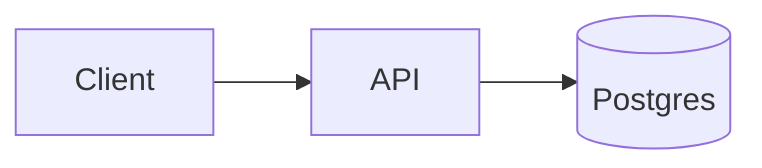

# Lab 01-04 - TechDocs: docs-as-code, CI build, external storage

## Goal
Publish docs with MkDocs in CI to object storage and have Backstage only *read* them (the recommended production strategy), instead of building docs inside the portal.

## Prereqs
Lab 01-02, Docker, a service repo with `catalog-info.yaml` annotated `backstage.io/techdocs-ref: dir:.`. MinIO from Module 05 Lab 03 (S3 API) serves as storage; Azure Blob/GCS config is shown.

## Step 1 - Docs in the service repo
```bash
cd payments-api
cat > mkdocs.yml <<'EOF'
site_name: payments-api
nav:
  - Home: index.md
  - Runbooks:
      - High error rate: runbooks/errors.md
  - ADRs:
      - 0001 Idempotent payments: adr/0001-idempotency.md
plugins: [techdocs-core]
EOF
mkdir -p docs/runbooks docs/adr
cat > docs/index.md <<'EOF'
# payments-api
Owner: team-payments. On-call: PagerDuty `payments`.
## Architecture

EOF
cat > docs/runbooks/errors.md <<'EOF'
# High error rate
1. Check dashboard. 2. Check last deploy (ArgoCD). 3. Roll back via git revert.
EOF
echo "# 0001 Idempotent payments\nStatus: accepted" > docs/adr/0001-idempotency.md
```
Preview locally with the same toolchain Backstage uses:
```bash
npx @techdocs/cli serve        # http://localhost:3000 (needs Docker; uses spotify/techdocs image)
```

## Step 2 - Strategy decision: where docs are built
| | `local` (Backstage builds on demand) | `external` (CI builds, Backstage reads) |
|---|---|---|
| Backstage needs docker/python | yes (build in backend) | no |
| First view latency | slow, build on request | fast |
| Scale/security | build runs in the portal pod | portal is read-only |
| Production fit | demos only | **recommended** |
Config:
```yaml
techdocs:
  builder: 'external'
  generator: { runIn: 'docker' }
  publisher:
    type: 'awsS3'
    awsS3:
      bucketName: techdocs
      endpoint: http://localhost:9000        # MinIO in the lab; omit for real S3
      s3ForcePathStyle: true
      credentials: { accessKeyId: ${TD_KEY}, secretAccessKey: ${TD_SECRET} }
```
Azure Blob: `publisher: { type: 'azureBlobStorage', azureBlobStorage: { containerName: techdocs, credentials: { accountName: ..., accountKey: ... } } }` (prefer managed identity/workload identity in AKS and no keys). GCS: `type: googleGcs`.

## Step 3 - Publish from CI (reusable workflow)
Create the bucket and publish manually first (typed by hand):
```bash
docker run --rm --network host --entrypoint sh quay.io/minio/mc -c "mc alias set l http://localhost:9000 tfadmin tfadmin-secret-123 && mc mb -p l/techdocs"
npx @techdocs/cli generate --source-dir . --output-dir ./site --no-docker 2>/dev/null || npx @techdocs/cli generate --source-dir . --output-dir ./site
AWS_ACCESS_KEY_ID=tfadmin AWS_SECRET_ACCESS_KEY=tfadmin-secret-123 AWS_REGION=us-east-1 \
  npx @techdocs/cli publish --publisher-type awsS3 --storage-name techdocs --awsEndpoint http://localhost:9000 \
  --awsS3ForcePathStyle --entity default/component/payments-api --directory ./site
```
The `--entity` must equal `namespace/kind/name` of the catalog entity. Then in Backstage: entity -> Docs tab renders from the bucket. Platform workflow version (CI):
```yaml
# acme-platform-workflows/.github/workflows/techdocs.yml
on: { workflow_call: { inputs: { entity: { type: string, required: true } } } }
permissions: { contents: read, id-token: write }
jobs:
  publish:
    runs-on: ubuntu-latest
    steps:
      - uses: actions/checkout@SHA
      - uses: actions/setup-node@SHA
        with: { node-version: 20 }
      - run: pip install mkdocs-techdocs-core==1.* 
      - run: npx @techdocs/cli generate --no-docker --source-dir . --output-dir site
      - uses: azure/login@SHA
        with: { client-id: "${{ vars.AZURE_CLIENT_ID }}", tenant-id: "${{ vars.AZURE_TENANT_ID }}", subscription-id: "${{ vars.AZURE_SUBSCRIPTION_ID }}" }
      - run: npx @techdocs/cli publish --publisher-type azureBlobStorage --storage-name techdocs --azureAccountName acmetechdocs --entity ${{ inputs.entity }} --directory site
```
Trigger on pushes to `main` that touch `docs/**` or `mkdocs.yml`. Template skeletons include the caller so every service has docs from day one.

## Step 4 - Quality and adoption
- Docs lint in CI: `markdownlint`, link check (`lychee`), `mkdocs build --strict`.
- Required docs set as a scorecard check ("has docs, has runbook, updated in last 6 months"): Lab 05.
- Search: enable the TechDocs collator so docs appear in Backstage search (`@backstage/plugin-search-backend-module-techdocs`).
- Metrics: docs views, 404s/search misses, % components with docs, freshness.
- Cross-doc standards: shared MkDocs config/theme via a platform `mkdocs` base; ADR template; runbook template with owner/pager/rollback sections.

## Break it on purpose
1. Mismatch `--entity` casing/namespace: Docs tab says "entity has no docs"; compare bucket path with entity ref.
2. Remove the `techdocs-core` plugin: build fails; CI blocks it.
3. Make the bucket private without credentials in Backstage: 403 in backend logs.

## Cleanup
`mc rm -r --force l/techdocs`

## Talking points
CI-built docs with external storage, entity-ref path contract, identity-based storage access, docs checks in CI and scorecards, search integration, docs adoption metrics.
