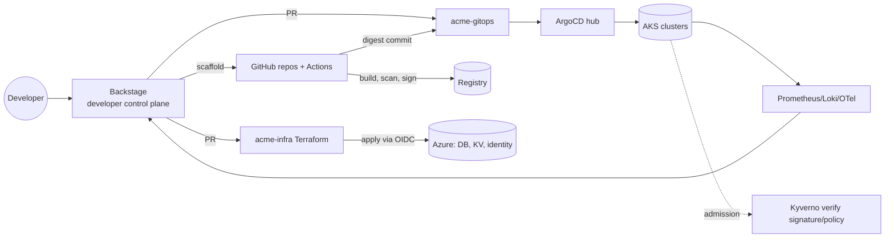

# Lab 02-01 - Platform architecture and the thinnest viable platform

## Goal
Produce the artifacts a Staff engineer brings to a platform design review: a capability inventory built from real data, the architecture mapped to planes, a "thinnest viable platform" (TVP) cut, and an ADR. Hands-on with git, `gh`, `jq`: no slideware.

## Prereqs
GitHub org with the Acme repos from earlier modules (or your employer's org for practice); `gh`, `jq`.

## Step 1 - Capability inventory from evidence
Ask "what do teams do today?" with data, not opinions.
```bash
ORG=acme-lab-<you>
gh repo list $ORG --limit 500 --json name,primaryLanguage,pushedAt,isArchived,repositoryTopics \
 | jq -r '.[] | select(.isArchived|not) | [.name, (.primaryLanguage.name//"-"), .pushedAt[:10]] | @tsv' | column -t | head -30
gh repo list $ORG --limit 500 --json primaryLanguage --jq '[.[].primaryLanguage.name] | group_by(.) | map({lang: .[0], n: length}) | sort_by(-.n)'
```
Count how services are built/deployed today:
```bash
gh search code --owner $ORG --filename Jenkinsfile --json repository --jq '.|length'
gh search code --owner $ORG 'path:.github/workflows' --json repository --jq '[.[].repository.nameWithOwner]|unique|length'
gh search code --owner $ORG 'kubectl apply' --json repository --jq '[.[].repository.nameWithOwner]|unique|length'
gh search code --owner $ORG 'FROM ' --filename Dockerfile --json repository --jq '[.[].repository.nameWithOwner]|unique|length'
```
Record: languages, CI systems, deploy methods, runtimes. The top 2-3 combinations define the first golden paths (80/20). Add qualitative inputs: 10 developer interviews, support-channel top questions (what are people asking for?), incident data (what breaks?). Output a table:

| Capability | Today (evidence) | Pain (1-5) | Reach (teams) | Candidate for platform? |
|---|---|---|---|---|
| Create new service | 3 wiki pages, 2 weeks | 5 | all | yes |
| Provision DB | JIRA ticket, 5 days | 5 | 60 % | yes |
| Deploy to prod | mix Jenkins/kubectl | 4 | all | yes |
| Observability setup | per-team | 3 | all | later |

## Step 2 - Map capabilities to the planes (the architecture)
Write `architecture.md` in the platform repo and a Mermaid diagram (GitHub renders it):
````markdown

````
For each box write: owner (team), SLO, interface (API/CLI/UI), failure mode and what developers see when it is down. That is the "platform as a product" contract.

## Step 3 - Team Topologies: thinnest viable platform
TVP = the smallest platform that removes the most cognitive load from stream-aligned teams. Run the exercise:
1. List what a stream-aligned team must know today to ship (cognitive load inventory): Kubernetes, Helm, Terraform, CI, secrets, monitoring, security scanning, DNS, certs...
2. For each, decide: **platform provides it by default** (invisible), **platform provides it as self-service** (one click/PR), or **team owns** (their domain).
3. First release scope = items that are high pain AND high reach AND cheap to build. Everything else is a later increment or "wiki + links" (thinnest!).
Example cut (quarter 1): service golden path (repo + CI + deploy), namespace-as-a-service, secrets via ESO, standard dashboards. Deferred: custom autoscaling policies, multi-region DR automation, ML platform.
Interaction modes to name: platform team offers **X-as-a-Service** (default), time-boxed **collaboration** when a new capability is built with a pilot team, and **facilitating** (enabling team style office hours). Anti-patterns: platform as ticket queue, mandating before value, building the "everything platform", platform team coupling to app releases.

## Step 4 - Interfaces: how do developers consume the platform?
| Interface | Use for | Example |
|---|---|---|
| UI (Backstage) | discovery, one-off creation, visibility | scaffolder template |
| Git/PR | desired state, review, audit | gitops overlay, infra PR |
| CLI | power users, automation | `acme` CLI wrapping APIs (optional) |
| API / K8s CRD | programmatic, composable | `StorageBucket` claim |
Principle: **everything the UI does is available through git or API** (no click-only features), so automation and audits work.

## Step 5 - Platform SLOs and support model
Write them down (publish in docs):
- Availability: Backstage 99.9 %, CI queue time p95 < 60 s, ArgoCD sync latency p95 < 2 min, template success rate > 98 %, new service time-to-first-deploy p50 < 60 min.
- Support: office hours twice a week, Slack channel with a response SLA (4 business hours), on-call for platform-critical components (ArgoCD, CI, ingress), incident comms template, status page.
- Change management: monthly platform release notes, deprecation policy (announce 2 quarters), RFC for breaking changes.

## Step 6 - ADR: record the decisions
```bash
mkdir -p docs/adr && cat > docs/adr/0001-platform-scope.md <<'EOF'
# ADR 0001: Platform scope and interfaces
Status: accepted | Date: 2026-11-01 | Deciders: platform team, SRE, security
## Context
60 services, 4 CI systems, deploy methods vary; median new-service time 12 days; 40% of tickets are provisioning requests.
## Decision
Build a thin platform: Backstage + golden path for Java and Node on AKS, GitOps via ArgoCD, Terraform product modules via PR, ESO for secrets. Everything is available through git; the UI wraps it.
## Consequences
+ Cuts new-service time to < 1 day; standardises security controls.
- Platform team owns on-call for CI/ArgoCD; we defer a custom CLI and ML workloads.
## Alternatives considered
Buy Humanitec/Port (rejected for workflow fit and cost at our scale, see ADR 0004); do nothing (rejected: 40% ticket load).
## Success metrics
Time-to-first-deploy p50 < 60 min, golden-path adoption > 70% of new services in 2 quarters, DORA lead time -30%.
EOF
git add -A && git commit -m "docs: ADR 0001 platform scope" 
```
A good ADR states context, decision, consequences (positive and negative), alternatives, and **how you will know it worked**.

## Break it on purpose
1. Try to put an item in TVP that is high pain but low reach (one team's niche tool): what is the argument? (Inner-source it or enable them; don't bloat.)
2. Remove "everything available through git" and see what breaks for audit and automation: a click-only workflow cannot be reviewed or replayed.

## Talking points
Evidence-based inventory, planes with owners/SLOs, TVP as scope discipline, interaction modes, UI wraps git/API, ADRs with success metrics.
